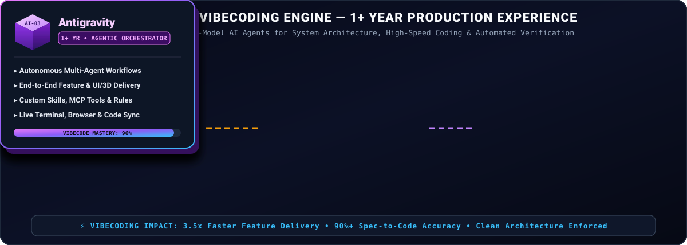
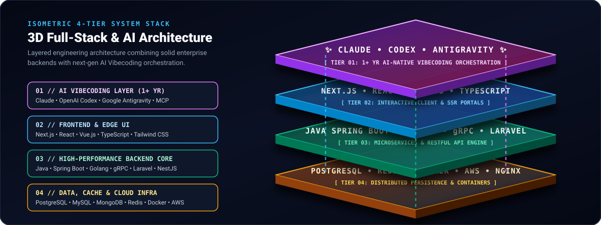

<div align="center">

<!-- 3D Isometric Animated Hero Stage -->
<a href="https://toannguyenit.com/">
  
</a>

<br />

<!-- Dynamic Typing Header -->
<a href="https://toannguyenit.com/">
  
</a>

<p align="center">
  <a href="https://toannguyenit.com/">
    
  </a>
  <a href="https://www.linkedin.com/in/nguyenvosongtoan/">
    
  </a>
  <a href="https://leetcode.com/u/user6628i/">
    
  </a>
  <a href="https://www.hackerrank.com/profile/toannguyen_hcmu1">
    
  </a>
  <a href="https://youtube.com/@nguyenvosongtoan">
    
  </a>
  <a href="https://www.facebook.com/nguyenvosongtoan">
    
  </a>
</p>

</div>

---

## 👨‍💻 About Me

I am a results-driven **Software Engineer** specializing in high-performance backend systems, distributed **Microservices**, and **AI-Native Software Engineering**. Over the past year, I have deeply integrated **AI Vibecoding workflows** (**Claude**, **OpenAI Codex**, and **Google Antigravity**) into enterprise software delivery—combining strict architectural foundations (**SOLID, DDD, Clean Architecture**) with autonomous multi-agent execution to ship production-ready systems at **3.5x velocity**.

```yaml
engineer_profile:
  name: "toannguyenit"
  location: "Ho Chi Minh City, Vietnam 🇻🇳"
  website: "https://toannguyenit.com/"
  core_focus:
    - "Enterprise Backend Architecture (Java Spring Boot, Golang, Laravel, NestJS)"
    - "High-Concurrency Microservices, gRPC & Distributed Caching (Redis, PostgreSQL)"
    - "AI-Native Vibecoding & Multi-Agent Engineering (1+ Year Practical Experience)"
  ai_vibecode_stack:
    experience: "1+ Year Intensive Production & Product Vibecoding"
    engines:
      - "Claude (Anthropic)   -> Deep System Design, Complex Refactoring & Edge-Case Auditing"
      - "OpenAI Codex         -> High-Speed Code Synthesis, Test Suites & CI/CD Automation"
      - "Google Antigravity   -> Autonomous Multi-Agent Orchestration, Custom Skills & 3D/Full-Stack Delivery"
  engineering_philosophy: "Architect with precision, orchestrate AI with intent, and ship resilient code."
```

- 🔭 **Currently Building:** **Enterprise Preschool Management System** (Java/Spring Boot) & **KTech College Medical App** (Laravel/Vue/Redis).
- 🤖 **1+ Year Vibecoding Mastery:** Architecting specs, custom agent rules, MCP integrations, and multi-agent pipelines using **Claude**, **Codex**, and **Antigravity**.
- 🌱 **Deepening Expertise:** **Go (Golang)** high-throughput microservices, **gRPC**, distributed locks, and event-driven systems.
- 👯 **Open for Collaboration:** Scalable backend systems, AI-augmented engineering workflows, and open-source developer tools.

---

## 🧊 AI-Native Vibecoding Arsenal (1+ Year Experience)

<div align="center">
  
</div>

<br />

<div align="center">

[](#)
[](#)
[](#)
[](#)

</div>

| AI Engine / Platform | Experience | Core Vibecoding Role & Production Workflow | Engineering Impact |
| :--- | :---: | :--- | :--- |
| **🟠 Claude (Anthropic)** | **`1+ Year`** | **System Architect & Deep Reasoning Partner:** Domain-Driven Design (DDD), database schema modeling, complex SQL query optimization, and deep architectural code reviews. | Eliminates design bottlenecks & catches subtle concurrency/security edge cases early. |
| **🟢 OpenAI Codex** | **`1+ Year`** | **High-Velocity Execution & Test Engine:** Rapid scaffolding of REST/gRPC endpoints, DTOs, unit/integration test suites, Dockerfiles, and automated bug triage across repositories. | Accelerates boilerplate & test coverage generation by **4x** with strict type safety. |
| **🟣 Google Antigravity** | **`1+ Year`** | **Autonomous Multi-Agent Orchestrator:** End-to-end feature execution across backend, frontend, terminal, and browser using custom `SKILL.md` modules, rules, and MCP tools. | Turns complex multi-file specifications into verified, production-ready features. |

---

## ⚡ 3D System Architecture & Interactive Tech Arsenal

<div align="center">
  
</div>

<br />

<div align="center">

| Domain Layer | Interactive Tech Icons | Key Technologies & Ecosystem |
| :--- | :---: | :--- |
| **☕ Languages & Core** | <a href="https://skillicons.dev"></a> | `Java` • `Go (Golang)` • `PHP` • `Python` • `TypeScript` • `JavaScript` |
| **🚀 Backend & Frontend Frameworks** | <a href="https://skillicons.dev"></a> | `Spring Boot` • `Laravel` • `NestJS` • `React` • `Next.js` • `Vue.js` |
| **🗄️ Databases & High-Speed Cache** | <a href="https://skillicons.dev"></a> | `PostgreSQL` • `MySQL` • `MongoDB` • `Redis` |
| **☁️ DevOps, Cloud & Tooling** | <a href="https://skillicons.dev"></a> | `Docker` • `AWS` • `NGINX` • `Git` • `Linux` • `Postman` |

<br />

### 🛠️ Complete Full-Stack & Cloud Matrix

<p align="center">
  <a href="https://skillicons.dev">
    
  </a>
</p>

</div>

---

## 🚀 Featured Projects & Production Experience

| Project | Tech & AI Stack | Architectural Highlights & Key Contributions | Status / Live |
| :--- | :--- | :--- | :---: |
| **🏫 Enterprise Preschool Management System** | `Java` `Spring Boot` `PostgreSQL` `Docker` `React` <br/> *(AI-Accelerated with Claude & Antigravity)* | Architected core backend modules for student lifecycle tracking, automated tuition billing, attendance, and granular RBAC authorization. Tuned complex PostgreSQL reporting queries for sub-100ms response times. |  |
| **🏥 KTech College Medical App** | `Laravel` `MySQL` `Redis` `Vue.js` <br/> *(AI-Accelerated with Codex & Claude)* | Engineered RESTful APIs for real-time appointment booking, electronic medical records (EMR), and automated SMS/email queues. Implemented **Redis** caching layers to offload high-frequency read traffic. |  |
| **⚡ Go Microservices Sandbox** | `Go (Golang)` `gRPC` `PostgreSQL` `Redis` `Docker` | High-throughput distributed microservice template featuring JWT security, Protobuf/gRPC inter-service communication, clean hexagonal architecture, and multi-stage Docker deployments. |  |
| **🌐 Technical Portfolio & Engineering Blog** | `Next.js` `React` `TypeScript` `Tailwind CSS` | Personal engineering hub showcasing system design articles, backend performance guides, AI Vibecoding workflows, and interactive project showcases. | [](https://toannguyenit.com/) |

---

## 💡 Core Engineering Competencies

<table>
  <tr>
    <td width="50%" valign="top">
      <h3>🏗️ Distributed Backend Architecture</h3>
      <ul>
        <li>Designing resilient <b>Monolithic &amp; Microservices</b> systems with clear bounded contexts.</li>
        <li>Building high-concurrency RESTful &amp; <b>gRPC</b> APIs adhering to <b>SOLID</b> and Clean Architecture.</li>
        <li>Implementing robust authentication/authorization (JWT, OAuth2, RBAC) and fault-tolerant API gateways.</li>
      </ul>
    </td>
    <td width="50%" valign="top">
      <h3>🤖 AI-Augmented Engineering (Vibecoding)</h3>
      <ul>
        <li><b>1+ Year Experience</b> combining <b>Claude, Codex &amp; Antigravity</b> for spec-driven development.</li>
        <li>Authoring structured prompts, custom agent skills, and architectural guardrails to keep AI-generated code clean and maintainable.</li>
        <li>Rapid prototyping, automated test synthesis, and zero-regression refactoring at scale.</li>
      </ul>
    </td>
  </tr>
  <tr>
    <td width="50%" valign="top">
      <h3>⚡ Database &amp; Caching Optimization</h3>
      <ul>
        <li>Relational schema design, composite indexing strategies, and query execution plan tuning (<b>PostgreSQL / MySQL</b>).</li>
        <li>High-speed caching patterns (Cache-Aside, Write-Through, TTL eviction) and message queuing with <b>Redis</b>.</li>
        <li>Preventing N+1 queries, deadlocks, and race conditions in high-traffic transactional workflows.</li>
      </ul>
    </td>
    <td width="50%" valign="top">
      <h3>🐳 Cloud, Containers &amp; Delivery</h3>
      <ul>
        <li>Containerizing multi-service environments with <b>Docker &amp; Docker Compose</b> for reproducible deployments.</li>
        <li>Configuring <b>NGINX</b> reverse proxies, SSL termination, load balancing, and cloud hosting on <b>AWS</b>.</li>
        <li>Proactive problem-solving, structured code reviews, and clear technical documentation.</li>
      </ul>
    </td>
  </tr>
</table>

---

<div align="center">

### 📝 Explore my technical articles & system design notes at [**toannguyenit.com**](https://toannguyenit.com/)

*“Clean architecture gives software its backbone; AI Vibecoding gives engineering its wings.”* ✨


</div>
