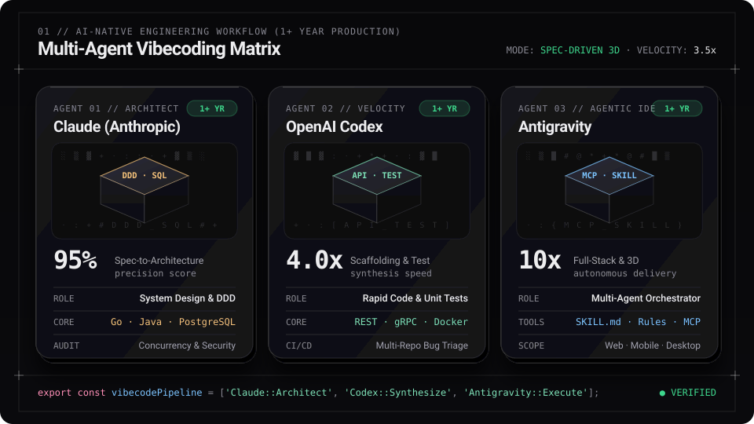
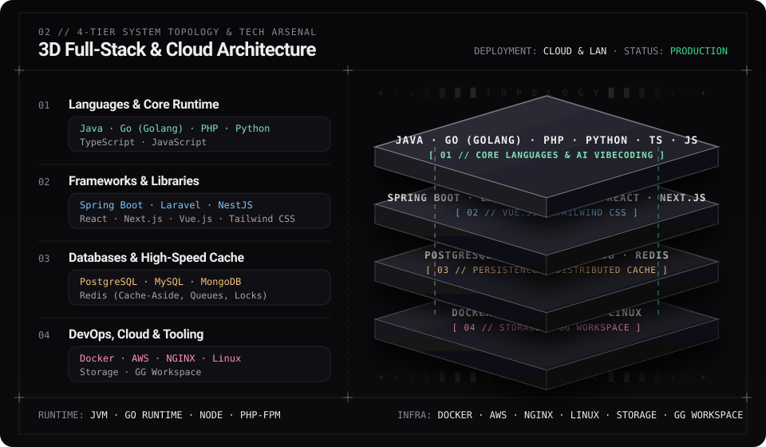

<div align="center">

<!-- 3D Isometric & ASCII-Reveal Hero Stage -->
<a href="https://toannguyenit.com/">
  
</a>

<br />

<!-- Dynamic Monochrome Typing Telemetry -->
<a href="https://toannguyenit.com/">
  
</a>

<p align="center">
  <a href="https://toannguyenit.com/">
    
  </a>
  <a href="https://www.linkedin.com/in/nguyenvosongtoan/">
    
  </a>
  <a href="https://leetcode.com/u/user6628i/">
    
  </a>
  <a href="https://www.hackerrank.com/profile/toannguyen_hcmu1">
    
  </a>
  <a href="https://youtube.com/@nguyenvosongtoan">
    
  </a>
  <a href="https://www.facebook.com/nguyenvosongtoan">
    
  </a>
</p>

</div>

---

## `00 //` 👨‍💻 About Me & Current Focus

I am a results-driven **Software Engineer** specializing in high-performance backend systems, distributed **Microservices**, and **AI-Native Software Engineering**. Over the past year, I have deeply integrated **AI Vibecoding workflows** (**Claude**, **OpenAI Codex**, and **Google Antigravity**) into enterprise software delivery—combining strict architectural foundations (**SOLID, DDD, Clean Architecture**) with autonomous multi-agent execution to ship production-ready systems at **3.5x velocity**.

```yaml
engineer_profile:
  handle: "toannguyenit"
  location: "Ho Chi Minh City, Vietnam 🇻🇳"
  website: "https://toannguyenit.com/"
  current_mission:
    ecosystem: "Enterprise Multi-Platform Ecosystem (Web · Mobile App · Desktop App)"
    topology: "Hybrid Cloud & On-Premise LAN"
    modules: ["Task & Workflow Management", "Internal Tools", "R&D Systems", "AI Analytics & Digitization"]
  ai_vibecode_stack:
    experience: "1+ Year Production Vibecoding"
    agents:
      claude: "System Architecture, DDD, Complex SQL & Security Auditing"
      codex: "High-Speed API Scaffolding, Automated Testing & Multi-Repo CI/CD"
      antigravity: "Autonomous Multi-Agent Orchestration, Custom Skills & Full-Stack Delivery"
```

- 🚀 **Đang xây dựng (`Currently Building`):** Ứng dụng AI và kỹ thuật phần mềm xây dựng **Hệ sinh thái cho doanh nghiệp** bao gồm **Web, Mobile App, Desktop App (Cloud & LAN)** với các hạng mục: Quản lý công việc, công cụ, R&D, tích hợp AI để phân tích và chuyển đổi số liệu — tối ưu quy trình, tăng năng suất, giảm rủi ro và bảo mật.
- 🔭 **Đã hoàn thành (`Delivered Systems`):** **Hệ thống Quản lý Trường Mầm non Doanh nghiệp** (*Enterprise Preschool Management System*) & **Hệ thống và Ứng dụng Y tế** (*Medical App*).
- 🤖 **Làm chủ Vibecoding (`1+ Năm`):** Thiết kế đặc tả (*Spec-driven*), xây dựng Agent Rules, tích hợp MCP và điều phối luồng đa tác tử (*Multi-Agent Pipelines*) cùng **Claude**, **Codex**, **Antigravity**.
- 🌱 **Đang đào sâu (`Deepening`):** Microservices chịu tải cao với **Go (Golang)**, **gRPC**, Distributed Locks và kiến trúc hướng sự kiện (*Event-Driven Architecture*).
- 👯 **Sẵn sàng hợp tác (`Collaboration`):** Các dự án hệ thống Backend mở rộng quy mô lớn, quy trình kỹ thuật ứng dụng AI và công cụ mã nguồn mở.

---

## `01 //` 🧊 AI-Native Vibecoding Matrix (1+ Year Experience)

<div align="center">
  
</div>

<br />

| Agent Engine | Experience | Production Vibecoding Role | Measured Impact |
| :--- | :---: | :--- | :--- |
| **Claude (Anthropic)** | `1+ Year` | **System Architect & Deep Reasoning:** Domain-Driven Design (DDD), relational schema modeling, complex SQL/GORM optimization, and concurrency/security auditing. | **95% Spec Accuracy** — eliminates architectural bottlenecks early. |
| **OpenAI Codex** | `1+ Year` | **Velocity & Test Synthesis Engine:** Rapid scaffolding of REST/gRPC APIs, DTOs, automated Unit/Integration test suites, Dockerfiles, and multi-repo bug triage. | **4.0x Faster Scaffolding** & high-coverage automated verification. |
| **Google Antigravity** | `1+ Year` | **Autonomous Multi-Agent Orchestrator:** End-to-end feature execution across backend, frontend, terminal, and browser using custom `SKILL.md` modules, rules, and MCP tools. | **10x Agentic Workflow** across Web, Mobile, and Desktop repositories. |

---

## `02 //` ⚡ Kiến trúc Hệ thống 4 Tầng & Công nghệ Sử dụng

<div align="center">
  
</div>

<br />

<div align="center">

| Phân tầng Hệ thống | Biểu tượng Công nghệ | Hệ sinh thái & Công cụ Cốt lõi |
| :--- | :---: | :--- |
| **☕ Ngôn ngữ lập trình** | <a href="https://skillicons.dev"></a> | `Java` · `Go (Golang)` · `PHP` · `Python` · `TypeScript` · `JavaScript` |
| **🚀 Frameworks & Thư viện** | <a href="https://skillicons.dev"></a> | `Spring Boot` · `Laravel` · `NestJS` · `React` · `Next.js` · `Vue.js` · `Tailwind CSS` |
| **🗄️ Cơ sở dữ liệu & Bộ nhớ đệm** | <a href="https://skillicons.dev"></a> | `PostgreSQL` · `MySQL` · `MongoDB` · `Redis` |
| **☁️ DevOps, Cloud & Công cụ** | <a href="https://skillicons.dev"></a> | `Docker` · `AWS` · `NGINX` · `Linux` · `Storage` · `GG Workspace` |

</div>

---

## `03 //` 🚀 Dự án Tiêu biểu & Kinh nghiệm Thực tế

| Dự án / Hệ thống | Công nghệ & AI Stack | Điểm nhấn Kiến trúc & Đóng góp Chính | Trạng thái |
| :--- | :--- | :--- | :---: |
| **🏢 Hệ sinh thái Doanh nghiệp & AI (Enterprise Ecosystem)** | `Go` `Java` `React` `Web · Mobile · Desktop` `Cloud & LAN` <br/> *(Claude · Codex · Antigravity)* | Xây dựng hệ sinh thái đa nền tảng (**Web, Mobile App, Desktop App** trên **Cloud & LAN**) gồm Quản lý công việc, công cụ nội bộ, R&D và tích hợp AI phân tích, chuyển đổi số liệu. Tối ưu quy trình, tăng năng suất, giảm rủi ro và bảo mật. |  |
| **🏫 Hệ thống Quản lý Mầm non (Enterprise Preschool Management System)** | `Go` `GORM` `PostgreSQL` `Docker` `React` <br/> *(Tăng tốc với Claude & Antigravity)* | Xây dựng các phân hệ cốt lõi quản lý hồ sơ học sinh, tính học phí tự động, điểm danh và phân quyền RBAC chi tiết. Tối ưu hóa các truy vấn báo cáo PostgreSQL phức tạp đạt thời gian phản hồi dưới `100ms`. |  |
| **🏥 Ứng dụng Y tế (Medical App)** | `Spring Boot` `MySQL` `Redis` `Next.js` <br/> *(Tăng tốc với Codex & Claude)* | Phát triển hệ thống RESTful API đặt lịch khám trực tuyến, hồ sơ bệnh án điện tử (EMR) và hàng đợi gửi thông báo SMS/Email tự động. Tích hợp **Redis** caching giảm tải cho các truy vấn đọc tần suất cao. |  |
| **⚡ Go Microservices Sandbox** | `Go (Golang)` `gRPC` `PostgreSQL` `Redis` `Docker` | Khung kiến trúc Microservice chịu tải cao tích hợp xác thực JWT, giao tiếp nội bộ qua Protobuf/gRPC, kiến trúc Hexagonal sạch và đóng gói Docker đa tầng (multi-stage). |  |
| **🌐 Technical Portfolio & Engineering Blog** | `Next.js` `React` `TypeScript` `Tailwind CSS` | Chuyên trang chia sẻ kiến thức thiết kế hệ thống, tối ưu hiệu năng Backend, quy trình AI Vibecoding và danh mục sản phẩm công nghệ. | [](https://toannguyenit.com/) |

---

## `04 //` 💡 Năng lực Chuyên môn Cốt lõi

<table>
  <tr>
    <td width="50%" valign="top">
      <h3><code>01</code> · Kiến trúc Backend Phân tán</h3>
      <ul>
        <li>Thiết kế hệ thống <b>Monolithic &amp; Microservices</b> chịu tải cao trên cả môi trường <b>Cloud &amp; On-Premise LAN</b>.</li>
        <li>Xây dựng RESTful &amp; <b>gRPC</b> API tuân thủ <b>SOLID</b>, Clean Architecture và bảo mật đa lớp (JWT, OAuth2, RBAC).</li>
      </ul>
    </td>
    <td width="50%" valign="top">
      <h3><code>02</code> · AI-Native Vibecoding (1+ Năm)</h3>
      <ul>
        <li>Điều phối bộ ba <b>Claude, Codex &amp; Antigravity</b> theo quy trình <b>Spec-driven development</b>.</li>
        <li>Thiết lập Agent Rules, custom <code>SKILL.md</code> và MCP Tools giúp nhân bản tốc độ phát triển lên <b>3.5x</b> mà vẫn giữ chuẩn kiến trúc sạch.</li>
      </ul>
    </td>
  </tr>
  <tr>
    <td width="50%" valign="top">
      <h3><code>03</code> · Tối ưu CSDL &amp; Distributed Cache</h3>
      <ul>
        <li>Thiết kế lược đồ quan hệ, tối ưu Composite Index và Execution Plan trên <b>PostgreSQL / MySQL</b> (độ trễ truy vấn báo cáo <code>&lt;100ms</code>).</li>
        <li>Triển khai <b>Redis</b> cho Cache-Aside, hàng đợi bất đồng bộ (Message Queues) và Distributed Locks chống race condition.</li>
      </ul>
    </td>
    <td width="50%" valign="top">
      <h3><code>04</code> · Hạ tầng Cloud, Storage &amp; Vận hành</h3>
      <ul>
        <li>Đóng gói môi trường đa dịch vụ với <b>Docker</b>, quản trị <b>Linux</b>, cấu hình <b>NGINX</b> reverse proxy &amp; cân bằng tải trên <b>AWS</b>.</li>
        <li>Quản lý lưu trữ phân tán (<b>Storage</b>) và tự động hóa quy trình làm việc doanh nghiệp với <b>GG Workspace</b>.</li>
      </ul>
    </td>
  </tr>
</table>

---

<div align="center">

```text
+--------------------------------------------------------------------------------------------------+
|  >_ toannguyenit  ·  https://toannguyenit.com/  ·  ARCHITECT WITH PRECISION, SHIP WITH AI        |
+--------------------------------------------------------------------------------------------------+
```

</div>
