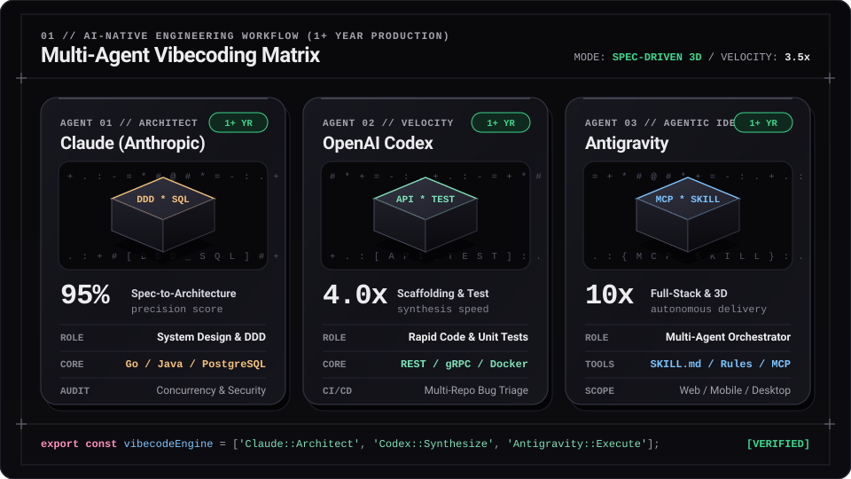
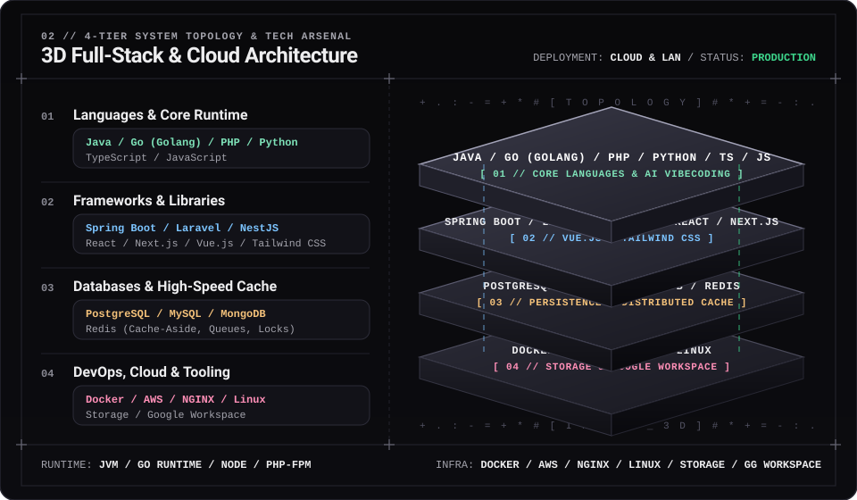

<div align="center">

<!-- 3D Isometric & ASCII-Reveal Hero Stage -->
<a href="https://toannguyenit.com/">
  
</a>

<br />

<!-- Dynamic Monochrome Typing Telemetry -->
<a href="https://toannguyenit.com/">
  
</a>

<p align="center">
  <a href="https://toannguyenit.com/">
    
  </a>
  <a href="https://www.linkedin.com/in/nguyenvosongtoan/">
    
  </a>
  <a href="https://leetcode.com/u/user6628i/">
    
  </a>
  <a href="https://www.hackerrank.com/profile/toannguyen_hcmu1">
    
  </a>
  <a href="https://youtube.com/@nguyenvosongtoan">
    
  </a>
  <a href="https://www.facebook.com/nguyenvosongtoan">
    
  </a>
</p>

</div>

---

## `00 //` 👨‍💻 About Me & Current Focus

I am a results-driven **Software Engineer** specializing in high-performance backend systems, distributed **Microservices**, and **AI-Native Software Engineering**. Over the past year, I have deeply integrated **AI Vibecoding workflows** (**Claude**, **OpenAI Codex**, and **Google Antigravity**) into enterprise software delivery—combining strict architectural foundations (**SOLID, DDD, Clean Architecture**) with autonomous multi-agent execution to ship production-ready systems at **3.5x velocity**.

```yaml
engineer_profile:
  handle: "toannguyenit"
  location: "Ho Chi Minh City, Vietnam"
  website: "https://toannguyenit.com/"
  current_mission:
    ecosystem: "Enterprise Multi-Platform Ecosystem (Web / Mobile App / Desktop App)"
    deployment: "Hybrid Cloud & On-Premise LAN"
    modules: ["Task & Workflow Management", "Internal Tools", "R&D Platforms", "AI Analytics & Digitization"]
  ai_vibecode_stack:
    experience: "1+ Year Production Vibecoding"
    agents:
      claude: "System Architecture, DDD, Complex SQL & Security Auditing"
      codex: "High-Speed API Scaffolding, Automated Testing & Multi-Repo CI/CD"
      antigravity: "Autonomous Multi-Agent Orchestration, Custom Skills & Full-Stack Delivery"
```

- 🚀 **Currently Building:** Applying AI and software engineering to build an end-to-end **Enterprise Ecosystem** across **Web, Mobile App, and Desktop App (Cloud & LAN)**—featuring **Task & Workflow Management, Internal Tools, R&D Platforms, and AI-Driven Data Analytics & Digitalization** to streamline processes, maximize productivity, reduce operational risks, and enforce enterprise security.
- 🔭 **Delivered Systems:** **Enterprise Preschool Management System** & **Healthcare System and Medical App**.
- 🤖 **1+ Year Vibecoding Mastery:** Spec-driven development, custom Agent Rules, MCP integrations, and orchestrating **Multi-Agent Pipelines** with **Claude**, **Codex**, and **Antigravity**.
- 🌱 **Deepening Expertise:** High-throughput microservices with **Go (Golang)**, **gRPC**, Distributed Locks, and Event-Driven Architecture.
- 👯 **Open for Collaboration:** Large-scale distributed backend systems, AI-augmented engineering workflows, and open-source developer tools.

---

## `01 //` 🧊 AI-Native Vibecoding Matrix (1+ Year Experience)

<div align="center">
  
</div>

<br />

| Agent Engine | Experience | Production Vibecoding Role | Measured Impact |
| :--- | :---: | :--- | :--- |
| **Claude (Anthropic)** | `1+ Year` | **System Architect & Deep Reasoning:** Domain-Driven Design (DDD), relational schema modeling, complex SQL/GORM optimization, and concurrency/security auditing. | **95% Spec Accuracy** — eliminates architectural bottlenecks early. |
| **OpenAI Codex** | `1+ Year` | **Velocity & Test Synthesis Engine:** Rapid scaffolding of REST/gRPC APIs, DTOs, automated Unit/Integration test suites, Dockerfiles, and multi-repo bug triage. | **4.0x Faster Scaffolding** & high-coverage automated verification. |
| **Google Antigravity** | `1+ Year` | **Autonomous Multi-Agent Orchestrator:** End-to-end feature execution across backend, frontend, terminal, and browser using custom `SKILL.md` modules, rules, and MCP tools. | **10x Agentic Workflow** across Web, Mobile, and Desktop repositories. |

---

## `02 //` ⚡ 4-Tier System Architecture & Tech Stack

<div align="center">
  
</div>

<br />

<div align="center">

| System Layer | Interactive Tech Icons | Core Technologies & Ecosystem |
| :--- | :---: | :--- |
| **☕ Languages & Core** | <a href="https://skillicons.dev"></a> | `Java` · `Go (Golang)` · `PHP` · `Python` · `TypeScript` · `JavaScript` |
| **🚀 Frameworks & Libraries** | <a href="https://skillicons.dev"></a> | `Spring Boot` · `Laravel` · `NestJS` · `React` · `Next.js` · `Vue.js` · `Tailwind CSS` |
| **🗄️ Databases & High-Speed Cache** | <a href="https://skillicons.dev"></a> | `PostgreSQL` · `MySQL` · `MongoDB` · `Redis` |
| **☁️ DevOps, Cloud & Tooling** | <a href="https://skillicons.dev"></a> | `Docker` · `AWS` · `NGINX` · `Linux` · `Storage` · `Google Workspace` |

</div>

---

## `03 //` 🚀 Featured Projects & Production Experience

| Project / System | Tech & AI Stack | Architectural Highlights & Key Contributions | Status |
| :--- | :--- | :--- | :---: |
| **🏢 Enterprise AI & Multi-Platform Ecosystem** | `Go` `Java` `React` `Web / Mobile / Desktop` `Cloud & LAN` <br/> *(Claude · Codex · Antigravity)* | Architecting a unified enterprise ecosystem across **Web, Mobile App & Desktop App (Cloud & On-Premise LAN)** covering **Task & Workflow Management, Internal Tools, R&D**, and **AI-driven data analytics & digitization** to boost productivity, minimize risks, and enforce strict security. |  |
| **🏫 Enterprise Preschool Management System** | `Go` `GORM` `PostgreSQL` `Docker` `React` <br/> *(Accelerated with Claude & Antigravity)* | Built core backend modules for student lifecycle management, automated tuition billing, attendance tracking, and granular RBAC authorization. Optimized complex PostgreSQL reporting queries for sub-100ms latency. |  |
| **🏥 Medical App (Healthcare System)** | `Spring Boot` `MySQL` `Redis` `Next.js` <br/> *(Accelerated with Codex & Claude)* | Developed RESTful APIs for online appointment scheduling, electronic medical records (EMR), and automated SMS/email notification queues. Integrated **Redis** caching layers to offload high-frequency read traffic. |  |
| **⚡ Go Microservices Sandbox** | `Go (Golang)` `gRPC` `PostgreSQL` `Redis` `Docker` | High-throughput distributed microservice template featuring JWT authentication, Protobuf/gRPC inter-service communication, clean hexagonal architecture, and multi-stage Docker deployments. |  |
| **🌐 Technical Portfolio & Engineering Blog** | `Next.js` `React` `TypeScript` `Tailwind CSS` | Personal engineering hub showcasing system design articles, backend performance guides, AI Vibecoding workflows, and interactive project portfolios. | [](https://toannguyenit.com/) |

---

## `04 //` 💡 Core Engineering Competencies

<table>
  <tr>
    <td width="50%" valign="top">
      <h3><code>01</code> · Distributed Backend Architecture</h3>
      <ul>
        <li>Designing resilient <b>Monolithic &amp; Microservices</b> architectures across both <b>Cloud &amp; On-Premise LAN</b> environments.</li>
        <li>Building high-concurrency RESTful &amp; <b>gRPC</b> APIs adhering to <b>SOLID</b>, Clean Architecture, and multi-layered security (JWT, OAuth2, RBAC).</li>
      </ul>
    </td>
    <td width="50%" valign="top">
      <h3><code>02</code> · AI-Native Vibecoding (1+ Year)</h3>
      <ul>
        <li>Orchestrating <b>Claude, Codex &amp; Antigravity</b> through rigorous <b>Spec-driven development</b> workflows.</li>
        <li>Authoring custom Agent Rules, <code>SKILL.md</code> modules, and MCP Tools to achieve <b>3.5x delivery velocity</b> while maintaining strict code quality.</li>
      </ul>
    </td>
  </tr>
  <tr>
    <td width="50%" valign="top">
      <h3><code>03</code> · Database &amp; Distributed Cache</h3>
      <ul>
        <li>Relational schema modeling, Composite Indexing, and Execution Plan tuning on <b>PostgreSQL &amp; MySQL</b> (sub-100ms reporting queries).</li>
        <li>Implementing <b>Redis</b> for Cache-Aside, asynchronous message queues, and Distributed Locks to prevent race conditions.</li>
      </ul>
    </td>
    <td width="50%" valign="top">
      <h3><code>04</code> · Cloud, Storage &amp; Operations</h3>
      <ul>
        <li>Containerizing multi-service environments with <b>Docker</b>, administering <b>Linux</b> servers, and configuring <b>NGINX</b> reverse proxies &amp; load balancing on <b>AWS</b>.</li>
        <li>Managing distributed object/file <b>Storage</b> and automating enterprise workflows with <b>Google Workspace</b>.</li>
      </ul>
    </td>
  </tr>
</table>

---

<div align="center">

```text
+--------------------------------------------------------------------------------------------------+
|  >_ toannguyenit  //  https://toannguyenit.com/  //  ARCHITECT WITH PRECISION, SHIP WITH AI      |
+--------------------------------------------------------------------------------------------------+
```

</div>
